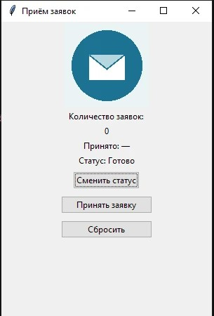

# Прием Заявок

Автор: Кулешов Роман
Группа: 11 ТЭС  
Версия программы: 0.2.1

## Назначение
для рабочих сфер где нужны приятие заявок, выполняет действие по принятию заявок

## Запуск
1) Открываем VS CODE
2) Запускаем програму (app_v02_готовая.py) в VS CODE
3) Запускаем файл .bat (ЗАПУСК_ПРОГРАММЫ_Windows.bat)

## Приём заявки
1. Нажимаем на кнопку принять заявку, она находится между сменить статус и сбросить
2. Должно поменятся число с 0 оно станет олин и так далее вплоть до 10, число находится над словом принято

## Смена статуса
После нажатия на кнопку сменить статус, меняется статус по очередно (Новая, В работе, Готово)

## Сброс счётчика
При нажатии на кнопку сбросить у нас сбрасывается количество заявок, оно опят становится 0

## Скриншот

## Если возникло затруднение
- Ситуация 1: если выдает ошибку( [Errno 2] No such file or directory ). Решение: проверить запушен ли VS CODE проверить запуск файла.bat
- Ситуация 2: [что произошло]. Решение: [что делать].

## Результат проверки
Проверяющий: Никифоров Даниил

[Какие действия выполнены по мануалу? Что получилось? Где возник вопрос? Проверили ли изображение?]

## Доработка
[Что изменили и как перепроверили. Если правки не понадобились, обоснуйте это результатами проверки.]
